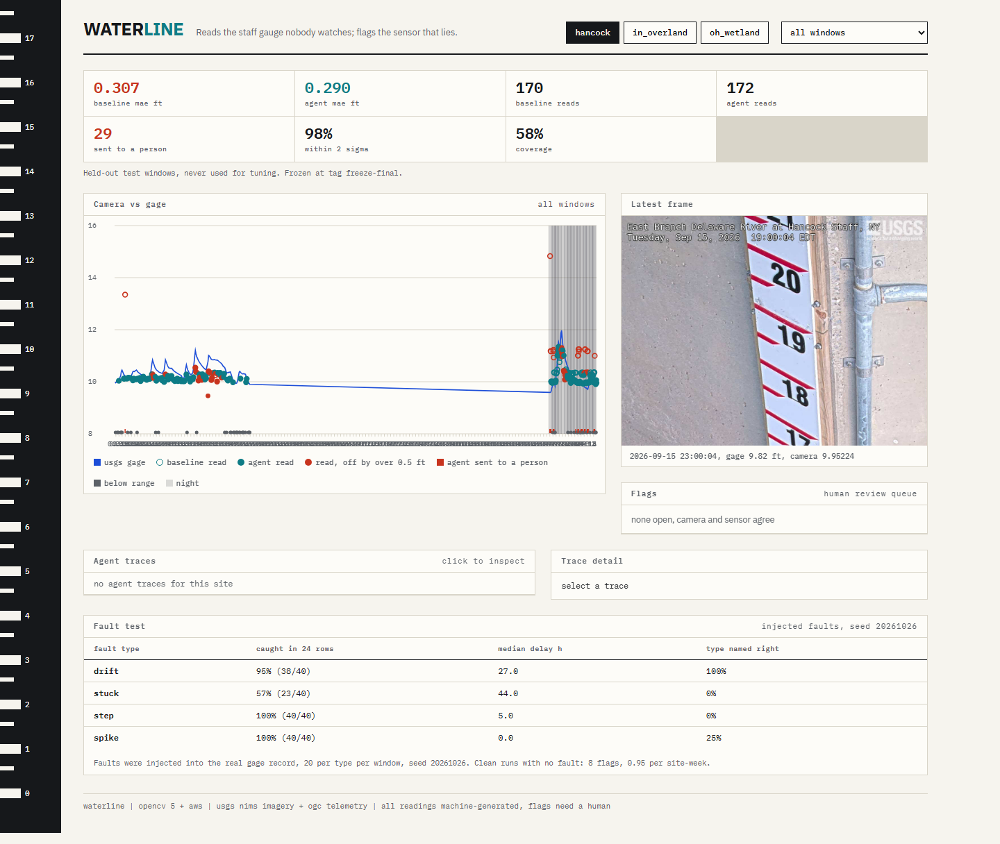
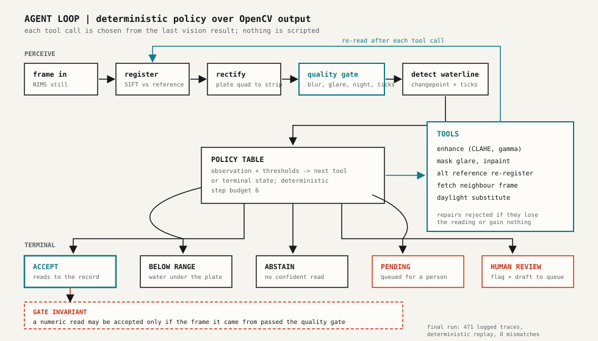
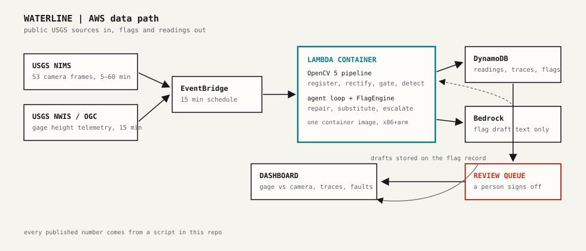

# Waterline

Waterline reads the staff gauges that USGS river cameras already see, checks every reading against the official sensor, takes another look or abstains when the picture cannot be trusted, and asks a technician to review the sensor when camera and gage disagree.

Entry for the OpenCV AI Competition 2026 (powered by AWS). Built on OpenCV 5 and AWS.



## Problem

USGS NIMS hosts thousands of river cameras pointed at staff gauges that nobody reads. The telemetry sensors that are supposed to report the water level drift, stick and spike, and the drift is found late. A camera that already watches the gauge can read it, and two independent measurements let each check the other.

## What it does

- Reads the staff gauge on each frame: SIFT registration against a site reference, a homography rectification of the plate to a strip, a quality gate (blur, glare, night, tick visibility), and a changepoint detector that finds the waterline row in the strip. Stage comes from an affine fit of detected row to gage feet.
- Runs a deterministic agent over the read: repair (CLAHE, gamma, glare mask), re-register against an alternate reference, fetch a neighbour frame, substitute a daylight frame for a night one, then accept, mark below range, abstain, or send to a person.
- Flags camera-vs-sensor disagreements: a z-scored CUSUM drift detector plus stuck, step and spike rules, with persistence and a draft review note.
- Serves a dashboard with the chart, the flags, the agent traces, the injected-fault test and a rule-picked failure gallery.

## Results

Held-out test windows, frozen at tag `freeze-final`. Numbers below are the committed pooled files; each table names the command that produced it.

Accuracy, `uv run waterline eval --final` (pooled in `results/final_summary_{site}.json` by `scripts/resume_final.py`):

| site | frames | baseline MAE ft | agent MAE ft | baseline reads | agent reads | sent to a person | within 2 sigma | coverage |
|---|---|---|---|---|---|---|---|---|
| hancock | 295 | 0.307 | 0.290 | 170 | 172 | 29 | 98.2% | 57.6% |
| in_overland | 1356 | 0.032 | 0.032 | 218 | 222 | 2 | 95.4% | 16.1% |

Injected faults on the agent series, `uv run waterline faults --final` (`results/final_faults_{site}.json`; 20 per type per window, seed 20261026, detection window 24 rows):

| site | fault | caught in window | median delay h | type named right | n/trials |
|---|---|---|---|---|---|
| hancock | drift | 95% | 27.0 | 100% | 38/40 |
| hancock | stuck | 58% | 44.0 | 0% | 23/40 |
| hancock | step | 100% | 5.0 | 0% | 40/40 |
| hancock | spike | 100% | 0.0 | 25% | 40/40 |
| in_overland | drift | 13% | 4.7 | 96% | 56/420 |
| in_overland | stuck | 20% | 2.4 | 10% | 83/420 |
| in_overland | step | 48% | 0.0 | 80% | 203/420 |
| in_overland | spike | 100% | 0.3 | 77% | 420/420 |

Clean-run flags (no fault injected): hancock 8 (0.95 per site-week), in_overland 4 (1.11 per site-week), listed in `results/final_flags_{site}.json` (`uv run python scripts/final_flags.py`).

Determinism check, `uv run python scripts/final_traces.py`: the frozen agent was replayed over every hancock frame and the 2026 in_overland windows; status, stage (to 1e-9) and source frame match the final CSVs with **0 mismatches** across 471 frames. Traces live in `results/final_traces/`.

## How the agent decides



Each tool call is chosen by the deterministic policy from what the last vision result returned. In the 471 final-run traces, 252 contain at least one tool call; by tool: fetch_next 125, mask_glare 122, enhance_gamma 44, enhance_clahe 37, alt_reference 37, fetch_prev 1 (from `results/exhibit_trace.json`, `uv run python scripts/trace_exhibit.py`).

`results/exhibit_trace.md` shows one full decision chain: the frame failed registration, the agent lifted contrast, re-registered, fetched the next frame when the lift failed, rejected a repair that lost the reading, and accepted at 0.52 ft against a gage of 0.50 ft.

## Where it fails

The dashboard section "Where it fails" and `results/gallery/` (`uv run python scripts/failure_gallery.py`) show two rule-picked cases per category: registration failed, night abstain, below plate, repair rejected, sent to a person, substitution, and largest agent error.

Honest limitations, all visible in the committed files:

- in_overland fault recall is weak where the fault needs camera reads: drift 13%, stuck 20%. The site is near-dry most of the time, so few windows carry enough accepted reads for the detector to work on.
- Hancock has 8 drift flags on the clean record, all with negative residuals (camera reads 0.33 to 0.86 ft low). That is a camera-side calibration bias, a false alarm, or both; the flags are listed in `results/final_flags_hancock.json`.
- The agent ties the baseline at in_overland (0.032 vs 0.032 ft MAE). At hancock the agent gains 0.017 ft MAE (0.290 vs 0.307), a small margin.
- 29 of 295 Hancock frames were sent to a person; they are the hard cases, not hidden ones.
- in_overland's affine calibration was fit on the same wet stretch that appears in its test windows (no disjoint wet period exists; see `eval/PROTOCOL.md` Amendment 2). Its accuracy numbers are partially in-sample; hancock's split is fully disjoint and is the headline claim.
- Registration decays with frame age at in_overland: pooled coverage by year is 10.7% (2023), 9.4% (2024), 22.1% (2025), 42.6% (2026), consistent with references being newer than the old frames (`results/final_summary_in_overland.json`, year blocks).

## Architecture



NIMS S3 imagery and NWIS gage telemetry feed an EventBridge schedule, which invokes a Lambda container running the OpenCV 5 pipeline and the agent. Readings, traces and flags go to DynamoDB, and the dashboard serves them. Bedrock is an optional chooser for the agent: when it is absent the deterministic policy runs, and the final evaluation used the deterministic policy only (every committed trace says `policy: deterministic`). The deployed AWS run is pending; the committed evaluation ran locally against the public USGS APIs.

## Reproduce

From a fresh clone (the image cache under `data/cache/` is not committed; the final-eval commands below download the frames again from USGS):

```powershell
uv sync
uv run python scripts/gate.py        # ruff, format, mypy, pytest
uv run waterline web --port 8711     # dashboard
```

Full held-out run (takes hours; each site, window and mode leg hits the public APIs):

```powershell
uv run waterline eval --final        # final_eval_*.csv + final_summary_*.json
uv run waterline faults --final      # final_faults_*.json
uv run python scripts/final_flags.py     # flags on the clean record
uv run python scripts/final_traces.py    # deterministic replay check
uv run python scripts/failure_gallery.py # gallery images
uv run python scripts/trace_exhibit.py   # decision exhibit
```

`scripts/fresh_clone_check.py` automates a lighter end-to-end check: clone, `uv sync`, gate, dashboard smoke test.

## Evaluation integrity

- Test windows were picked from the gage record alone, before any frame in them was processed (`eval/PROTOCOL.md` Amendment 5, `results/test_windows.json`).
- The agent and calibrations are frozen at tag `freeze-final` (commit `b370871`). `waterline eval --final` refuses to run if `eval/PROTOCOL.md` does not hash to `results/protocol_hash.txt` (`69e4e2543f8a519d9da328315a99834c20d3d77b13fa14ae6ebe8d0bbab5855c`).
- Everything that went wrong during the final run is written down in `results/FINAL_RUN_NOTES.md`: an out-of-memory crash resumed one leg per subprocess, two frames missing from USGS storage that the resume driver skipped, and a stray empty output file from the pooled faults command.
- Earlier dev results, including a retracted inflated number, stay in the git history; `docs/REPORT.md` covers them.

## Data and licenses

Code is Apache-2.0 (see `LICENSE`, `NOTICE`). USGS imagery and telemetry are public domain; see `NOTICE` for the attribution text. No faces or other personal data appear in the inputs or outputs.
