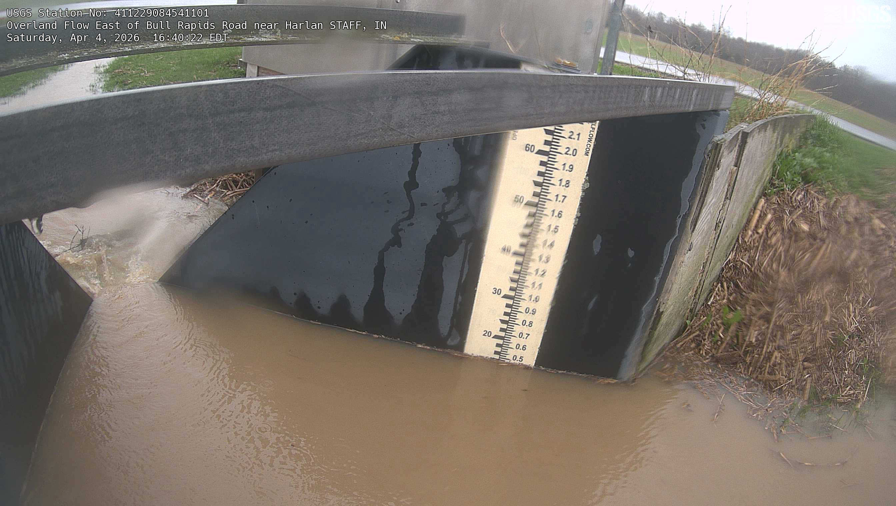
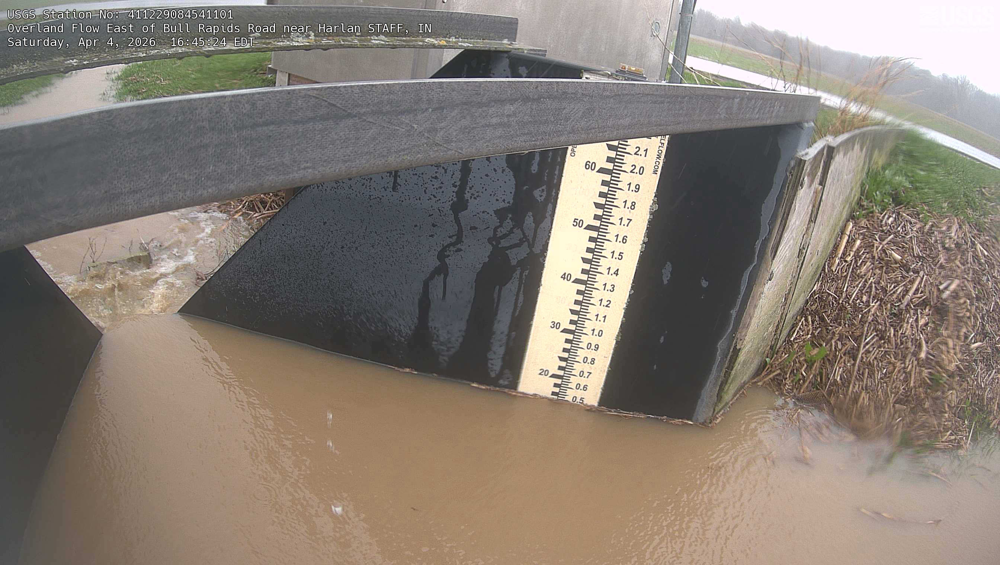

# Decision exhibit: in_overland-20260404T2045Z

Site in_overland, frame 2026-04-04T20:45:24Z. One frame's run on
the held-out test windows. Every tool call below was chosen by the
deterministic policy from what OpenCV reported for the current image,
not scripted: each row shows the observation and the threshold that
gated the branch.

| step | tool | what OpenCV reported | gating threshold | why this tool |
|---|---|---|---|---|
| 1 | enhance_gamma | stage=None sigma=None disagree=False reason=registration failed | inliers>=60, ratio>=0.35 | registration failed; try one contrast lift |
| 2 | fetch_next | stage=None sigma=None disagree=False reason=registration failed | inliers>=60, ratio>=0.35 | still cannot register; pull the next frame |
| 3 | mask_glare | stage=0.52 sigma=0.054 disagree=False reason=None | repair keeps the reading and gains sigma | repair rejected: lost the reading |

Final: **accepted** at 0.52 ft (gage 0.50 ft).

